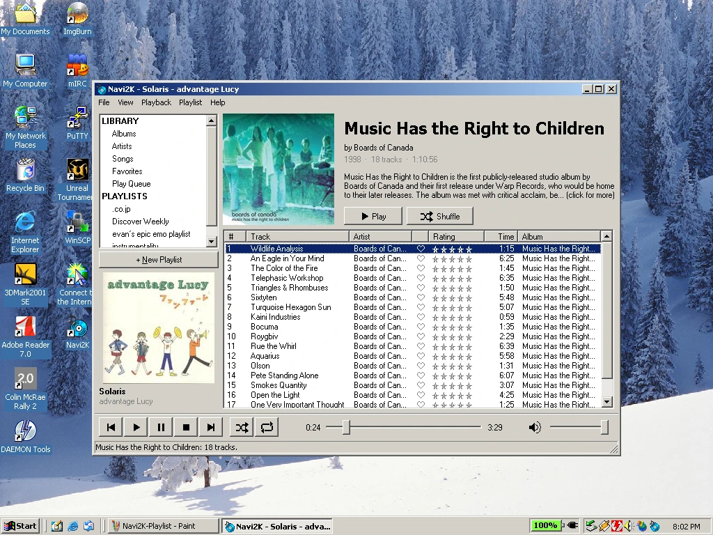
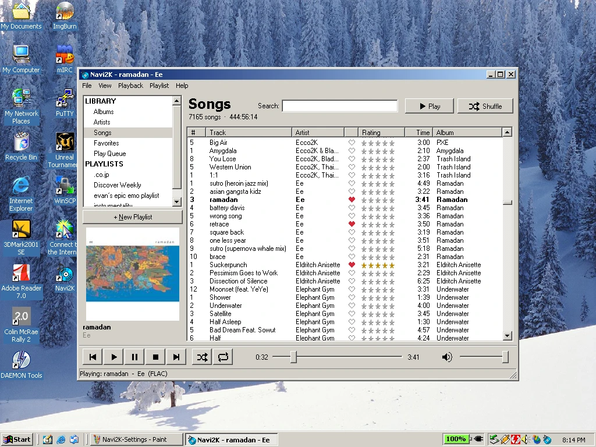
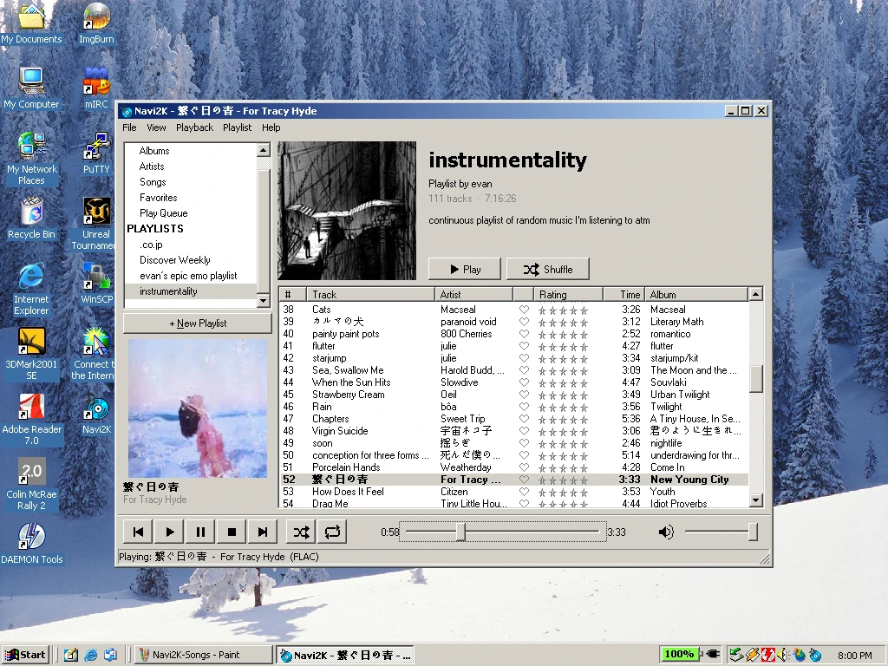
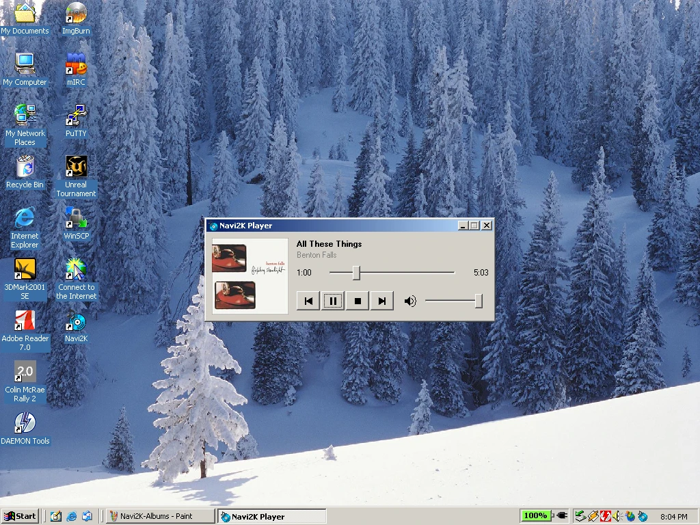

<p align="center">
  
</p>

<h1 align="center">Navi2K Player</h1>

<p align="center">
  A native music player for <a href="https://www.navidrome.org/">Navidrome</a> on Windows 95 and up.
</p>

<p align="center">
  <b>Windows 95 to 11</b> &nbsp;|&nbsp; <b>Pentium and up</b> &nbsp;|&nbsp; <b>A single small .exe, no runtimes</b>
</p>

<!-- Screenshots live in docs/screenshots. -->
<p align="center">
  
</p>

## Features

- Browse albums, artists, and songs, with search, cover art, and Discover lists
- Playlists you can create, edit, and reorder, plus a play queue
- Download tracks, albums, and playlists, and keep listening when the server is offline (plays are sent to Navidrome later)
- Star ratings, favorites, and scrobbling, synced with Navidrome
- Optional lossless FLAC playback, and gapless playback
- Japanese, Chinese, and Korean titles, even on Windows 95/98
- Album and artist descriptions from Last.fm
- Mini player, tray icon, keyboard shortcuts, and media keys

## Screenshots

<table>
  <tr>
    <td align="center" width="50%">
      <br>
      <sub>Songs, with ratings and favorites</sub>
    </td>
    <td align="center" width="50%">
      <br>
      <sub>A playlist, with Japanese titles</sub>
    </td>
  </tr>
  <tr>
    <td align="center" colspan="2">
      <br>
      <sub>Mini player (Ctrl+M)</sub>
    </td>
  </tr>
</table>

## Requirements

- Windows 95 and up (Windows 95 needs Internet Explorer 5 or later).
- A Pentium or newer CPU (Pentium MMX and AMD K6 included). Tested on a Pentium 90, where MP3 plays in real time.
- A Navidrome server with ffmpeg available (it is by default). Navidrome converts tracks to MP3 for the player, except FLAC files when Lossless is on.

## Setup

1. Copy `Navi2KPlayer.exe` to any folder and run it. Keep `DroidSansFallback.ttf` next to it if you want Japanese, Chinese, and Korean text on Windows 95/98/ME.
2. On first run, the Settings dialog opens. Enter your server address (for example `http://192.168.1.10:4533`), user name, and password. **Test Connection** checks them before you save.
3. Click **OK** to connect.

Logs are written to `Navi2KPlayer.log` next to the exe.

## Configuration

Everything is set in **File > Settings**. Settings are saved in `Navi2KPlayer.ini` next to the exe; your password is never stored, only a login token. [CONFIGURATION.md](CONFIGURATION.md) lists every ini key, for editing the file directly.

## Keyboard shortcuts

| Keys | Action |
|---|---|
| Ctrl+P (or Space in a track list) | Play / pause |
| Ctrl+S | Stop |
| Ctrl+B / Ctrl+N | Previous / next |
| Ctrl+H | Shuffle on or off |
| Ctrl+T | Repeat: off, all, one |
| Ctrl+Q | Play Queue |
| Ctrl+M | Mini player |
| Ctrl+F | Search |
| F5 | Reconnect |

The keyboard's media keys (play/pause, stop, previous, next) also work.

### HTTP vs. HTTPS

Older versions of Windows only support old encryption that modern servers reject. **Use plain HTTP on your local network**, for example `http://<server-ip>:4533`.

If you need access from outside your network, put a reverse proxy on your LAN that accepts TLS 1.0 and forwards requests to Navidrome.

## Windows 95, 98, and ME

Windows 95, 98, and ME have almost no Unicode support, so the player uses the system code page instead:

- Text in other scripts (ex. Japanese on an English Windows 98) shows in the player's lists, sidebar, and panels, but as `?` in the title bar, menus, search box, and dialogs. Japanese, Chinese, and Korean use the bundled `DroidSansFallback.ttf` (Apache 2.0, from the Android Open Source Project), loaded from the exe's folder for the session, or an installed font for the language.
- Download file names replace those characters with `_`.
- `Navi2KPlayer.ini` is an ANSI file. An ini copied from a newer Windows (UTF-16) can't be read on 9x.
- Media keys probably don't work on 95/98, and the tray tooltip is cut to 63 characters.

On newer Windows without East Asian language support, the same font is used for the player's lists and panels.

## Building

Build with 32-bit MinGW-w64 using the msvcrt runtime and win32 threads. UCRT builds won't run on older Windows. Each build is checked automatically, and fails if the `.exe` uses anything Windows 95 or a Pentium can't run.

```
cmake -G "MinGW Makefiles" -B build -DCMAKE_BUILD_TYPE=Release
cmake --build build
```
